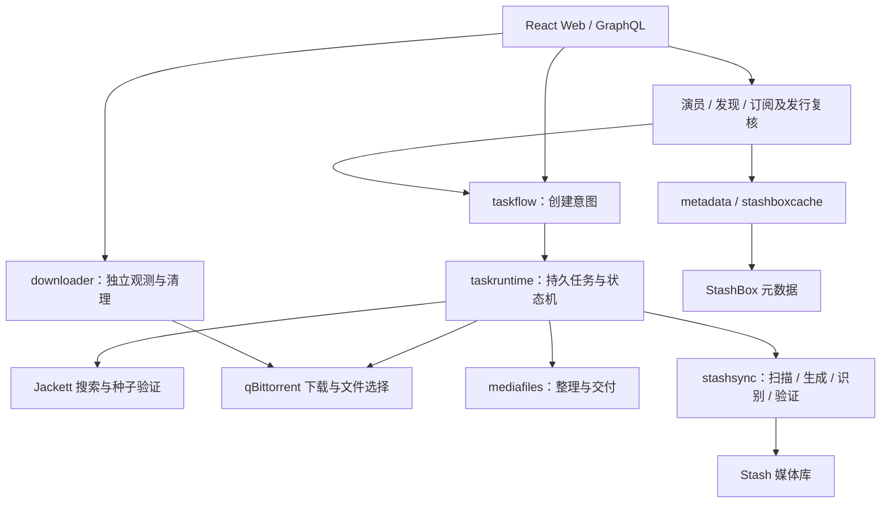

# 项目定位与架构地图

核对日期：2026-11-01；代码基线：`71ef6fa`；状态：当前架构与边界。工程变更遵守 [工程规范](standards/engineering.md)，审查证据及严重性见 [架构复核](reviews/2026-11-01-project-standards.md)。

## 产品目标

Moji 把“演员或影片意图”转为可恢复的下载与入库工作流。成功标准是后台能够持续完成自动化，失败时状态可信、原因可解释、用户有下一步可做。Stash 继续承担媒体库、元数据与播放资源管理；qBittorrent 负责 BT 传输；Jackett 负责索引搜索。

长期需要适应较大的演员库与任务历史，但“存在分页和限流”不等于已验证任意规模。当前规模边界见 [架构复核](reviews/2026-11-01-project-standards.md)，历史验证保留在对应日期复核，未完成工作见 [TODO](TODO.md)。

## 运行链

代码入口：[main.go](../cmd/moji/main.go)。启动先加载配置与日志，取得存储目录所有权并校验 generation，再组装客户端、领域服务、事件总线、GraphQL 和 HTTP 路由。随后启动寻源、下载器观测、任务推进、订阅调度、缓存清理、统计、备份维护和数据库性能采样。

关闭时取消应用 context，关闭订阅、停止 HTTP 接单并等待请求和 worker，最后关闭数据库。新的后台执行必须接入生命周期和等待机制；不要把请求 context 当作已接收后台作业的生命周期。

## 代码所有权

| 区域 | 负责什么 | 进一步阅读 |
| --- | --- | --- |
| `cmd/moji` | 依赖组装、工作循环、HTTP、运行设置 | [运维](modules/operations.md) |
| `cmd/moji-storage`、`internal/datamigration` | 离线准备、校验、激活与恢复；不初始化外部客户端 | [存储](modules/storage.md) |
| `internal/graphqlapi`、`graphql/moji` | 传输契约、错误、映射；业务规则在领域层 | [开发](workflows/development.md) |
| `internal/taskflow` | 创建意图和任务来源映射 | [任务](modules/tasks.md) |
| `internal/taskruntime` | 任务身份、持久化、寻源、下载、阶段推进、工作台与事件 | [任务](modules/tasks.md) |
| `internal/subscription` | 订阅动作、检查 reservation、待发行生命周期、发行策略和持久复核 | [订阅](modules/subscriptions.md) |
| `internal/performer`、`internal/discovery` | 演员读取、选片资格、发现与创建入口 | [目录](modules/catalog.md) |
| `internal/metadata`、`internal/stashboxcache` | 已配置 endpoint、演员映射和可重建目录缓存 | [目录](modules/catalog.md) |
| `internal/mediafiles`、`internal/stashsync` | 媒体产物、路径映射与 Stash 操作 | [媒体](modules/media.md) |
| `internal/storage`、`internal/durablefile` | 连接、迁移、恢复、原子文件持久化 | [存储](modules/storage.md) |
| `internal/downloader` | 独立 qB 观测、控制、保留策略与删除核对 | [运维](modules/operations.md) |
| `internal/imagecache` | 鉴权图片代理、磁盘缓存、头像派生图 | [目录](modules/catalog.md) |
| `internal/releasedate` | 发行日期校验与业务日历/时区，多个入口共享 | [订阅](modules/subscriptions.md) |
| `internal/stats`、`internal/logging` | 依赖状态、运行统计、日志与事件 | [运维](modules/operations.md) |
| `internal/controller/api`、`internal/webui` | 辅助 HTTP API、健康检查与 SPA 静态文件 | [运维](modules/operations.md) |
| `pkg/{stash,stashbox,jackett,qbittorrent}` | 可复用的外部服务客户端 | [运维](modules/operations.md) |
| `web/src` | 路由、实体缓存、领域 hooks、操作界面、帮助和 i18n | [Web](modules/web.md) |

## 状态真值

| 数据 | 真值 |
| --- | --- |
| 演员订阅标记、媒体库实体、识别元数据 | Stash；StashBox 提供外部目录 |
| 任务身份、选择、检查点、发行决定和外部意图 | generation 内核心库 `moji.db` |
| qB 实际存在、传输、做种情况 | 最近一次完整成功的 qB 观测，标注新鲜度 |
| 可重建进度和下载器观测 | 内存及 `runtime.db` |
| StashBox 目录缓存 | `cache/stashbox/cache.db`；不能替代上游身份校验 |
| 运行设置 | 指定的 YAML，由 config store 原子写入 |
| 交付产物与所有权回执 | 媒体目录与 `.moji-receipts` |
| 浏览器实体缓存与事件 | 展示和同步机制；刷新后从领域快照重建 |

核心决定与诊断分离，SQL 事务不跨网络、媒体处理或多个数据库文件。任务完成、下载完成和做种结束是不同事实。

## 可维护性结论

现有领域模块、任务创建入口、统一存储 owner 和前端共享组件是继续发展的基础。当前不需要以全仓重写或引入新框架解决组织问题。

高优先级风险是 [G-001](TODO.md#g-001) 的实际后端 CI 覆盖和 [S-001](TODO.md#s-001) 的全量上游读取；中等维护问题是 [A-001](TODO.md#a-001) 的跨业务设置编辑热点与 [A-002](TODO.md#a-002) 的过宽消费接口。后两项按实际改动增量收敛，不为了文件行数拆散同一状态机。证据、影响和本轮验证局限见日期复核，实施规则见工程规范。

## 有意保留的实现差异

- 生产使用 Manager 注入的 managed repositories；内存、JSON 和独立 SQLite 构造器仍用于测试或兼容路径。不能根据旧构造器推断生产布局。
- 实时总线不持久化，也没有通用 replay；任务使用 stream/sequence 快照恢复，订阅检查与下载器使用各自的受控轮询，性能数据采用推送。
- 历史全量检查只有 [提案](plans/performer-full-scan.md)，不能从现有手动检查推断已经扫描全部历史。
- 部署和用户操作的细节位于根 [README](../README.md) 和 [docs](../docs)，模块文档只记录开发需要保持的契约。
